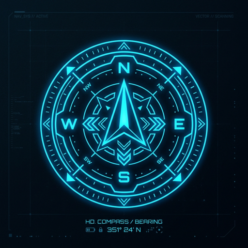

<p align="center">
  
</p>

# Navis Protocol

A local-first productivity and knowledge-management cockpit, built with Next.js,
FastAPI, and a Tauri desktop shell. It provides task boards, journals, progression,
map views, companion interfaces, and optional local/online AI integrations.

This public repository starts from a reviewed source snapshot with a single
initial commit. It contains no personal Vault, exported search results, runtime
databases, credentials, or prior private repository history.

## Development

Requirements: Python 3.11+, Node.js/npm, and a personal Vault stored outside this
repository. The desktop build also requires Rust and the Tauri Windows toolchain.

```powershell
python -m venv backend/.venv
backend/.venv/Scripts/python.exe -m pip install -r backend/requirements.txt -r backend/requirements-test.txt
npm ci
npm --prefix frontend ci
powershell -NoProfile -ExecutionPolicy Bypass -File scripts/install-gitleaks.ps1
$env:NAVIS_ROOT = 'C:\Path\To\Your\Vault'
.\start_all.vbs
```

`start_all.vbs` starts the backend on port 8000 and the web frontend on port 3000.
Set `NAVIS_ROOT` before launching; the compatibility default is documented in
[AGENTS.md](AGENTS.md). `Stop_Navis.bat` stops those listeners and the desktop app.
The launchers support `NAVIS_LAUNCH_DRY_RUN=1` for checking paths without starting
services or accessing a Vault.

Copy `frontend/.env.example` to ignored `frontend/.env.local` for a different API
URL. Backend `.env.example` documents process environment settings; launchers do
not automatically load that example. Never put private credentials in variables
prefixed `NEXT_PUBLIC_`, because Next.js exposes those to browser clients.

Cloud library search/import is optional and requires explicit `NAVIS_GCP_PROJECT`
and `NAVIS_GCS_BUCKET` configuration plus Google Application Default Credentials.
Local Ollama is the default AI provider; online use requires the existing opt-ins
and budget controls described in [docs/local-first-ai.md](docs/local-first-ai.md).

## Checks

```powershell
npm run security:test
npm run security:scan:tree
npm run security:scan
npm --prefix frontend test
npm --prefix frontend run lint
backend/.venv/Scripts/python.exe -m pytest backend/tests
```

Install the repository's hooks with `npm run prepare`. Missing Gitleaks blocks
commits/pushes; it does not silently skip scanning. See
[public repository hygiene](docs/public-repo-hygiene.md) for protected file types,
CI checks, and how to keep new personal data outside the repository.

## Project guides

- [Architecture](docs/architecture.md)
- [Security trust boundaries](docs/security-trust-boundaries.md)
- [Desktop development and release checks](docs/desktop-release.md)
- [Current roadmap](docs/roadmap.md)

Historical issue/PR links in older technical notes refer to the private development
archive. This public repository has its own issue and pull-request history.
