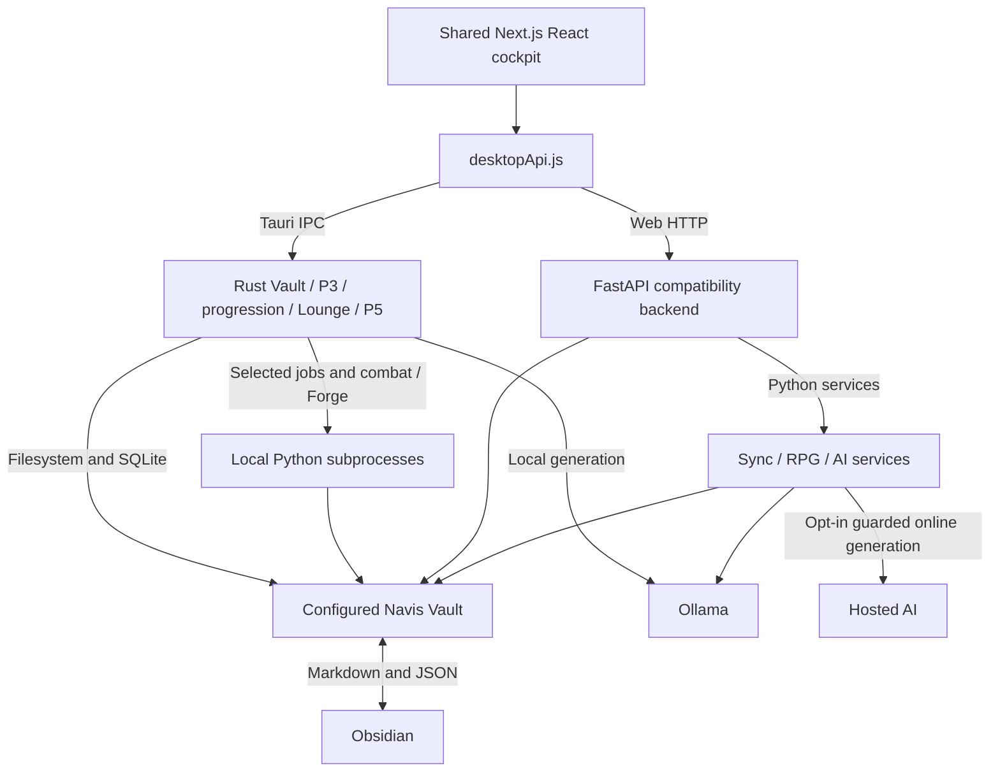

# 🏗️ Navis-Protocol Architectural Topology

This document details the architectural layout, data flow, and synchronization mechanisms governing the `Navis-Protocol` command portal.

## Progression and XP authority (P1 decision)

The canonical XP ledger is the per-entity append-only ledger in `Keeper/navis_progression.db`, keyed by stable entity ID and award ID. Keeper and each companion have separate ownership streams; squad membership determines eligible companion awards at award time, not ownership of historical XP. `Bridge/CompanionStats.json` is a derived compatibility projection of each entity's total XP and level for existing consumers. Markdown daily journals are source evidence for task completion, and `Keeper/XP.md` plus companion `XP.md` files are human-readable projections, never independent authority. Achievements remain a separate domain.

Each award must carry an immutable award ID, entity ID, integer signed amount, source type/reference, source event time and local award date, rule/version, provenance, and creation time. Retries with the same award ID are idempotent; replay rebuilds projections from ledger entries. Corrections use linked compensating entries and retain the original. Manual changes are explicit, attributed adjustment entries with a reason; no direct total edits are canonical.

The award's `local_date` is resolved once using the configured Navis local timezone and persisted; replay never reinterprets it using the machine's current timezone. Level is derived from cumulative XP using the current quadratic rule `max(1, floor(0.5 + sqrt(max(0, 0.25 + 2 * XP / 1000))))`, recorded here as the compatibility rule pending explicit product revision. Projections preserve legitimate negative totals; level remains at least 1.

Reconciliation imports only uniquely attributable records. Duplicate same-day Markdown entries are not presumed duplicates; identical migrated source rows need a stable source identity before deduplication. Missing records are not synthesized from totals. Opening balances may be represented as explicit opening-balance entries only when a source total/date is defensible, with source and confidence recorded. Ambiguous or conflicting history stays unresolved and is excluded from guessed awards. Unavailable Vault data fails closed: no zero balance, award, or projection overwrite is inferred.

## Progression P2 writer boundary

`xp_ledger` is the only XP write authority. It is append-only, scoped to `keeper` or `companion:<stable-name>`, and uniquely keyed by `award_id`; the existing `xp_logs` table remains read-only legacy data with unknown ownership until P3. FastAPI and the Tauri compatibility router use the same schema, validation rules, uniqueness behavior, entity totals, correction links, and level formula. Both use SQLite immediate transactions with a busy timeout. Repeating an identical ID is a no-op; reusing it with different content is rejected.

Journal replay records the original recipient cohort and the Navis `status.json.last_updated` local date in one transaction. A replay uses that stored cohort even after squad changes. If checked-task evidence changes, it appends a linked compensating entry and updates the source cursor; unchanged replay is idempotent. Missing journal/status data fails before award creation. Manual adjustments require a stable ID, entity, signed amount, event time, persisted local date, source, rule version, provenance actor, and reason. Corrections append linked entries; they never edit prior awards.

`Bridge/CompanionStats.json` receives derived `ledger_xp` and `ledger_level` fields. Its existing `xp` and `level` fields are preserved until P3 resolves their ambiguous history, so P2 does not overwrite or migrate production totals. `XP.md` files retain their existing text and receive a replaceable, clearly marked canonical ledger block. The database commits before per-file projections; each projection uses an atomic replacement (with a recoverable backup in Tauri). A projection error reports that the ledger is already committed and that replay repairs it. A later dashboard/read-consumer phase can switch legacy fields after P3 migration.

The supported XP writer boundary is the shared ledger API/service. Direct edits to XP totals in JSON or Markdown are not authoritative. Legacy `xp_logs` rows and existing XP Markdown entries are not imported or reconciled in P2; no production XP history was copied or rewritten.

### Current and legacy writer inventory

Current producers/consumers are:

- `backend/scripts/migrate_xp.py` defers legacy XP import to P3 and leaves the source Markdown untouched. Achievement import remains available.
- `backend/services/progression_db.py` preserves legacy `xp_logs` but adds canonical `xp_ledger` and replay cursors. FastAPI and Tauri award calls share the ledger schema and contracts; legacy rows do not enter entity totals.
- `backend/services/rpg_engine.py` reads checked task-list items from the Navis-local journal date, records the first recipient cohort transactionally, and projects canonical totals. Sync, rollover, and the web task-toggle use this writer; repeated journal evidence is idempotent and edits append corrections.
- `frontend/src-tauri/src/progression.rs` writes the same per-entity ledger transactions and marked JSON/Markdown projection formats as the Python API.
- `backend/main.py` serves entity-scoped canonical progression reads/writes. Existing status and companion consumers may continue reading legacy `xp`/`level` fields until P3/P4 switch them after reconciliation.

Representative **local-only, non-identifying** read-only checks (no journal text copied here): SQLite contains 78 XP rows totaling 4,056 through 2026-05-27; the archived Keeper Markdown projection ends at 4,134 through that date, so the sources disagree by 78. `CompanionStats.json` has 43 entities and Keeper at 9,436 XP (level 4), which differs substantially from both Keeper-only records. These totals cannot be reconciled from the inspected records alone: there is no entity key in SQLite rows, the migration's date/amount/details do not establish a unique award ID, and CompanionStats spans a broader or differently accumulated history. Keep the source records and uncertainty; do not publish raw records or overwrite Vault data during P1.

P2 delivers the ledger schema, stable award/provenance contracts, journal/manual writers, native/web parity, compatibility projections, and isolated behavioral fixtures. P3 provides a non-mutating inventory by default, operator-reviewed source mappings, verified backups, idempotent version/checkpoint state, a shared writer lock through projection verification, unresolved-history reporting, and verified rollback. It imports no history whose entity, identity, amount, or date cannot be defended. See [XP history reconciliation](xp-reconciliation.md). P4 (#71) is merged: the progression dashboard reads canonical ledger totals/history. Historical production reconciliation and packaged workflow checks are separate from this source implementation.

---

## Constellation Talent Tree Perk & Specialization Ledger (Epic #193, Talent-P1 #194)

The Constellation Talent Tree provides mechanical specialization and gameplay modifiers unlocked through skill points earned by advancing Keeper and companion levels.

### Authority & Schema Architecture
The persistent perk and allocation authority lives inside `Keeper/navis_progression.db`:
- `talent_nodes (id TEXT PRIMARY KEY, branch TEXT NOT NULL, tier INTEGER NOT NULL, prerequisites TEXT NOT NULL, max_rank INTEGER NOT NULL, perk_key TEXT NOT NULL, name TEXT NOT NULL, description TEXT NOT NULL)`: Catalog of constellation nodes across four branches (`Focus`, `Martial`, `Kinetic`, `Lore`), defining tree tiers, prerequisite node lists, max investable ranks, and mechanical perk keys.
- `talent_allocations (entity_id TEXT NOT NULL, node_id TEXT NOT NULL, rank INTEGER NOT NULL, allocated_at TEXT NOT NULL, PRIMARY KEY(entity_id, node_id), FOREIGN KEY(node_id) REFERENCES talent_nodes(id))`: Entity-scoped allocation records storing current invested ranks and allocation timestamps.

### Mathematical Point Derivation
Skill points are derived mathematically:
$$\text{Available Talent Points} = \max(0, \text{current\_level} - \text{total\_allocated\_ranks})$$
Where:
- $\text{current\_level} = \max(1, \lfloor 0.5 + \sqrt{\max(0, 0.25 + 2 \times \text{total\_xp} / 1000)} \rfloor)$
- $\text{total\_allocated\_ranks} = \sum \text{allocated ranks for entity}$

### Atomic Mutation Contract & Prerequisite Validation
Allocation requests (`POST /api/v1/progression/talents/allocate`) are processed inside SQLite immediate transactions (`BEGIN IMMEDIATE`):
1. **Entity & Node Validation**: Verifies entity identity (`keeper` or `companion:<name>`) and node existence.
2. **Prerequisite Verification**: Traverses prerequisites; dependent nodes require prerequisite nodes to be unlocked (rank $\ge 1$).
3. **Point Limit Checks**: Ensures $\text{available\_points} \ge \text{target\_rank} - \text{current\_rank}$.
4. **Rank Constraints**: Enforces $1 \le \text{target\_rank} \le \text{max\_rank}$ and rejects rank decrements.
5. **Idempotency**: Repeated requests with the already-allocated rank return success with zero additional points spent.

### Full Runtime Parity
FastAPI (`backend/services/talent_service.py`, `backend/main.py`) and native Tauri (`frontend/src-tauri/src/progression.rs`) share:
- Identical schemas and idempotent seed migrations.
- Shared routes: `GET /api/v1/progression/talents`, `GET /api/v1/progression/talents/nodes`, and `POST /api/v1/progression/talents/allocate`.
- Parity contracts verified in `frontend/src-tauri/tests/parity_contracts.rs` and `p3_parity.json`.

### Productivity Gameplay Modifiers & Telemetry Integration (Talent-P3 #196)
Allocated talent perks dynamically apply throughout the operational loop:
1. **Dynamic Task Completion Multipliers**:
   - `high_velocity_xp_bonus`: +10% XP yield per rank on High-Velocity Front mandates (capped at 50%).
   - `focus_deep_work_multiplier`: +10% XP yield per rank on Sanctum / Deep Work mandates (capped at 50%).
   - `kinetic_stamina_efficiency`: +10% XP yield per rank on Kinetic Outland mandates (capped at 50%).
   - `library_harvest_bonus`: +10% XP yield per rank on Bureaucratic Gauntlet mandates (capped at 50%).
   - `daily_outland_surge`: +2 XP flat expedition surge reward per rank on Outland completions (capped at 5 XP).
   - Bonus awards are recorded in `xp_ledger` distinctly with `source_type = "talent_perk"` and `reason = "talent_perk:<perk_key>"`.
2. **Tactical Combat Modifiers**:
   - `reduced_rollover_penalty`: Grants +10% combat shield boost per rank and reduces incoming enemy debuff penalties by 1 per rank.
   - `focus_stamina_boost`: Grants +10% combat shield boost per rank.
   - Combat shield bonuses stack additively with companion passives (`shield_percent`) up to the `PASSIVE_LIMITS` ceiling (100%).
   - `high_velocity_xp_bonus`: Grants critical strike XP multiplier amplification and awards distinct combat perk XP upon resolution.
3. **Weekly Holocron Telemetry**:
   - Telemetry queries aggregate talent contributions under `progression.xp_breakdown.talents` and detailed breakdown in `progression.talent_telemetry`.
   - `summary.talent_bonus_xp` surfaces weekly talent yields.
   - Tactical debrief notes Constellation amplification: `Constellation perks amplified operational yields by +<XP> XP`.
   - Standalone HTML dashboards render Constellation Yield honors chips alongside unlocked achievements.

---

## Combat-task completion contract (issue #85, P1 decision)

P2 implementation (#86): FastAPI and Tauri combat mutations use
`services/combat_completion.py`. Tauri invokes the bundled `native_combat.py`
through its existing local Python runtime, without requiring an HTTP service.
The client mints a resolution UUID when linking; the server persists it with
the bound source (and generates one for compatible non-UI callers). The source
contains a safe relative path, exact line, and SHA-256 of checkbox-normalized
line/context. Sources without a path are bound to the configured journal date
only when the exact task text occurs once. Missing, moved, edited, ambiguous,
or legacy unbound sources fail closed. Cancel (`is_completed=false`) releases
cards using their discard/burn rules and never writes a checkbox or awards XP.
Cancellation uses a separate stable key, so an already-completed outcome cannot
be overwritten with different input; repeating either command replays its record.

All combat writes hold a cross-process Vault battle lock. An atomic battle
state write stores `prepared` intent before the checkbox edit, followed by
`task_written`, `battle_committed`, `xp_sync_pending`, and `complete`. Source
files get a sibling `backup_combat_*` copy before an atomic byte-preserving
checkbox replacement. A retry of prepared intent can recognize a task write
whose acknowledgment failed; retries after the card commit only synchronize
the existing RPG ledger and finish the operation. The ledger's source-batch
idempotency preserves recipients and prevents repeat awards. Incomplete
operations remain in battle state and the cockpit exposes a retry action,
including when their active card link has already been consumed. Rest and
relink are blocked while conflicting recovery remains pending. Native runtime
failure is surfaced for repair/retry; no fallback claims task completion.

### Current representation and observed gap

Journal and operation tasks are Markdown checklist lines. Combat task completion in #86 binds an exact source at link creation and writes its checkbox before committing card transitions. Both FastAPI and the Tauri `p3::combat_request` subprocess bridge call `services/combat_completion.py`; native combat does not require an HTTP server. The general `/api/tasks/toggle` route remains separate. `BattleCockpit` inspects the resolve outcome, refreshes task/status views only after confirmed completion, and shows persisted recovery actions. Automated parity and restart evidence, with explicit remaining release checks, is recorded in [combat task verification](combat-task-verification.md).

### P2 identity and API contract

The authoritative completion record remains the source Markdown checkbox. Links persist the caller task ID, a generated resolution UUID (or a validated caller UUID), normalized Vault-relative path, line number, normalized checklist line, and SHA-256 fingerprint of surrounding lines. Completion state is excluded from the fingerprint so retries recognize an already-written checkbox. Absolute paths, traversal, non-task lines, duplicate matches, missing files, edited/moved lines and unresolved legacy links fail closed. No embedded Markdown task IDs or second task store are introduced.

Completion uses the `resolution_id` saved with the link and reused on retry. Repeating the same key with the same task/source/outcome returns the durable result without another checkbox/card transition or XP sync; changed inputs conflict. An already-checked source returns `already_completed` and retains the link without synchronizing XP. Cancellation uses a separate stable key, resolves cards only and leaves the checkbox/XP untouched. Cancel and relink invalid or legacy sources after refreshing them; never choose another line by fuzzy text.

### Cross-file persistence and recovery

The journal and `Battle/battle_state.json` cannot form one filesystem transaction. The shared service serializes combat mutations with an OS file lock and atomically saves durable `prepared`, `task_written`, `battle_committed`, `xp_sync_pending`, and `complete` checkpoints. It saves intent before changing the source, copies a pre-edit backup, replaces the journal atomically while changing only one checkbox byte, verifies the write, then commits card state. Failures reload the durable checkpoint and return `pending_recovery`; a fresh process can finish the original operation. XP retries use the existing RPG producer's idempotent canonical daily source ledger and original cohort. No separate combat XP award is added. An initial intent failure occurs before task mutation; a journal failure retains linked cards. Pending recovery blocks rest and competing outcomes.

Web and Tauri share valid request/outcome semantics: `task_id`, saved `resolution_id`, optional saved source, and `is_completed`; `completed`, `already_completed`, `cancelled` and `pending_recovery` outcomes include card and XP disposition. Validation/conflict errors use 400; FastAPI's request schema additionally uses 422 for missing fields. UI reports completion only after a confirmed completed outcome; persisted pending operations remain actionable after reload, even when their card link has already been removed.

### Representative fixtures

The committed `docs/fixtures/combat_task_completion.json` contains synthetic paths and task text only. Backend tests consume its response expectations across service, native adapter and HTTP TestClient workflows. Additional P3 fixtures assert fresh-process checkpoint recovery, concurrent duplicate requests, award-then-failure retry, original cohort preservation and daily XP deltas. Rust tests exercise the native subprocess/read boundary without HTTP. See the [verification record](combat-task-verification.md) for commands, results and separate manual release gaps.

## 🗺️ System Overview

Navis-Protocol shares a React cockpit between native Windows production and web/FastAPI compatibility modes. Neither native route coverage nor a passing fixture implies complete runtime parity.

---

## 🎛️ Key Tiers

### 1. Presentation Tier (Next.js)
- **Framework:** Next.js 14 (App router / Client-side SPA entry).
- **Core Viewport:** [page.js](../frontend/src/app/page.js) manages layout composition, navigation, and sidebar widgets.
- **Dynamic Renderers:** Markdown components ([MarkdownRenderer.js](../frontend/src/components/MarkdownRenderer.js)) parse files on the fly and replace checkboxes with interactive HTML widgets.

### 2. Compatibility Service Tier (FastAPI)
- **Framework:** FastAPI running via Uvicorn.
- **Key Functions:**
  - File Server: Directly serves files, images, and Markdown logs under `/api/vault`.
  - Operations Executor: Uses `backend/services/rpg_engine.py` and `sync_engine.py` for canonical XP and sync/rollover; some integrations still require Vault scripts.
  - Neural Arbiter: Handles configured local/online providers and chat. Native chat coverage is narrower; see the endpoint registry.

### Native service tier (Tauri v2)

`frontend/src-tauri/src/lib.rs` registers commands, the `vault` asset protocol, and managed operation state. `desktopApi.js` routes progression to `progression_request`, Lounge/library to `lounge_request`, battle/missions/cache to `p3_request`, Reid/neural/Forge/biometrics to `p5_request`, and remaining API paths to `vault_request`. Routing to a module does not mean that module implements every path. Unsupported routes reject or explicitly return unavailable; there is no automatic HTTP fallback.

Native sync/rollover POSTs use `start_sync_operation`, cancellation uses `cancel_sync_operation`, and progress arrives through `navis://operation`. Lounge and P5 have separate start/cancel commands. Aborting a dispatched API wait does not roll back writes or cancel a job. Vault assets use `vault://localhost/` (Windows WebView uses `http://vault.localhost/`) rather than the HTTP server.

Rust handles most reads and SQLite progression directly. Combat mutations invoke bundled `native_combat.py` and the shared completion service. Sync/rollover invoke bundled `native_operations.py`; Forge invokes bundled scripts/services. The interpreter is resolved locally; Python is not bundled. P5 allowlisted operations and some external integrations depend on scripts/data in the configured Vault. Resource declarations in `tauri.conf.json` are the packaging authority. See [release/runtime requirements](desktop-release.md) and [route coverage](api_endpoints.md).

### 3. Data Tier (Obsidian Vault)
- **Persistence:** Markdown and JSON evidence/state plus SQLite databases for canonical progression, Lounge/library and biometrics.
- **Bridge State (`status.json`):** Holds the unified, real-time status database (active squad, targeted beast/antagonist, current location).
- **Ledger Stats (`CompanionStats.json`):** Tracks companion levels, progression thresholds, and stat arrays.

### P4 canonical dashboard reads

ProgressionManifold consumes entity-scoped ledger totals and API/IPC level
thresholds directly. Legacy JSON totals do not drive this view. Award context
and linked corrections remain visible. See [P4 acceptance evidence](progression-p4-verification.md)
for automated fixture results and the remaining packaged desktop checks.

---

## Weekly Holocron Telemetry & Synthesis Engine (#179–182)

The Weekly Holocron engine (`backend/services/holocron_engine.py`) aggregates 7-day operating cycles (Monday through Sunday, ISO-8601 calendar) anchored to the canonical 03:00 local day boundary.

### Telemetry Pipeline
1. **Journal Parsing (`parse_daily_journal`):** Scans atomic daily Markdown journals (`Journal/YYYY/MM/YYYY-MM-DD.md` or flat `Journal/YYYY-MM-DD.md`) using `utf-8-sig` encoding. Counts completed (`- [x]`) and pending (`- [ ]`) task checkboxes, maps section headers to canonical Manors (Sanctum, High-Velocity Front, Domestic Breach, Bureaucratic Gauntlet, Kinetic Outland), extracts Realm and Prime Beast tokens, and tracks active squad member deployments.
2. **Progression Telemetry (`query_progression_telemetry`):** Queries `Keeper/navis_progression.db` for the 7-day date window to extract exact XP yield grouped by source type (tasks, combat, directives, missions) and achievements unlocked during the cycle.
3. **Week-to-Date (WTD) Mode:** When compiling the active in-flight week (`is_in_flight: true`), the engine marks concluded days, the active local day, and upcoming days, calculating `days_elapsed` and `days_remaining` without caching unfinalized artifacts as concluded.
4. **Local AI Tactical Debrief (`synthesize_ollama_debrief`):** Synthesizes a 2–3 sentence military-sci-fi/RPG tactical assessment via local Ollama (`OllamaProvider`). Adheres strictly to the local-first boundary with zero external cloud egress. If Ollama is offline or times out, the engine deterministically falls back to a template-driven rule-based debrief tagged as `rule_based_fallback`.
5. **Artifact Generation & Manifest:** Concluded cycles are persisted to `Bridge/Holocron/Weekly/{week_id}.json` and self-contained HTML dashboards (`{week_id}.html`). `Bridge/Holocron/weekly_manifest.json` maintains the index of all cycles sorted in reverse chronological order.
6. **Desktop Tauri IPC Bridge (`native_holocron.py`):** The desktop app routes `/api/holocron/*` via Tauri command `vault_request` to `vault::holocron_request`. Fast GET requests for cached artifacts are served directly by Rust; generation and AI debrief operations invoke allowlisted `backend/native_holocron.py` over stdio JSON with UTF-8 stream reconfiguring, executing without requiring a running FastAPI server.

